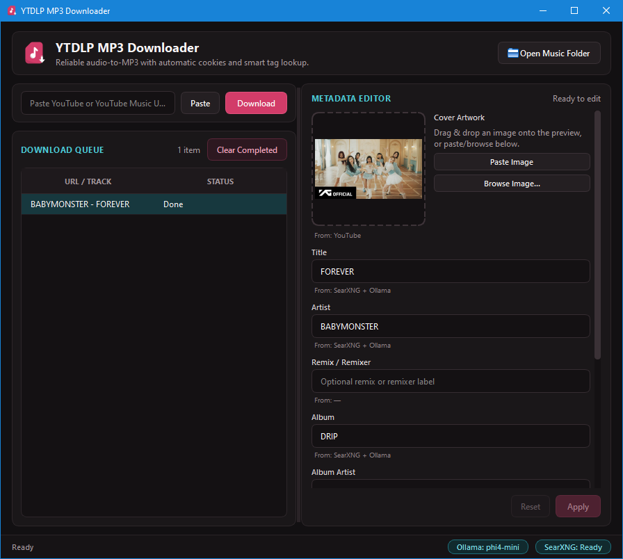

# ytdlp-mp3-downloader

A desktop and CLI tool for downloading YouTube audio as 192 kbps MP3s with proper ID3 tags and cover art. Built with Python, `yt-dlp`, `ffmpeg`, and a dark-themed PySide6 interface.



## What it does

- **Audio download**: Grabs the best audio stream from YouTube or YouTube Music and converts it to a 192 kbps MP3.
- **4-step tag completion**: Fills in missing tags (`Title`, `Artist`, `Album`, `Album Artist`, `Year`, `Genre`, and cover art) step by step and stops once everything is filled:
  1. **YouTube** — Pulls whatever structured track metadata and thumbnail YouTube already provides.
  2. **SearXNG + Ollama (`phi4-mini`)** — Searches SearXNG for track info and passes the results to local Ollama over HTTP (`keep_alive: 5m`) to clean up messy titles and separate the actual artist from reupload channels or remixers.
  3. **iTunes Search API** — Checks iTunes for any remaining empty fields or missing cover art.
  4. **SearXNG Image Search** — Falls back to an image search if the track still has no thumbnail.
- **File naming**: Saves tracks as `<artist> - <title> (<remixer>).mp3` (or `<artist> - <title>.mp3` when there's no remix).
- **Live Metadata Editor**:
  - Resizable two-pane PySide6 window with the download queue on the left and a tag editor on the right.
  - Selecting an active download lets you watch fields and cover art fill in live as each step finishes.
  - You can edit any field manually or drag-and-drop / paste a new cover image; edited fields get an amber border until you hit **Apply**.
  - Each field displays a small label underneath showing where its value came from during the current session (`YouTube`, `SearXNG + Ollama`, `iTunes`, `SearXNG Image`, or `Manual`).
- **Auto-generated config**: If `settings.json` is missing, the app recreates one with default values on startup.

## How cookies work

YouTube often blocks or throttles unauthenticated `yt-dlp` requests, or serves restricted streams when you aren't signed in. Instead of making you manually export cookie files with a browser extension, this app handles it automatically:

1. **Where they come from**: On the first download of a session, `browser-cookie3` reads your local `.youtube.com` cookies from installed browsers in this order: **Firefox** (tested), **Edge**, **Brave**, **Opera**, and **Chrome**.
2. **How they're used**: The extracted cookies are written to a temporary Netscape-format `cookies.txt` file (configurable in `settings.json`) and passed to `yt-dlp` along with standard desktop browser headers so YouTube treats the request like a normal browser session. If no browser cookies can be read, it falls back to a standard unauthenticated request.
3. **Cleanup**: `cookies.txt` is deleted automatically when the GUI starts up and again when you close the window, so stale session tokens aren't left sitting around.

## Setup

Make sure Python and `ffmpeg` are installed (`ffmpeg` needs to be on your system `PATH`).

```bash
git clone https://github.com/Zigatronz/ytdlp-mp3-downloader
cd ytdlp-mp3-downloader
python -m pip install -r requirements.txt
```

You can double-check `ffmpeg` by running:

```bash
ffmpeg -version
```

### Optional: Ollama & SearXNG

If you want the AI title cleanup and web/image fallback steps to run, have these available locally (or point `settings.json` to your own endpoints):

- **Ollama** at `http://localhost:11434` with `phi4-mini` pulled (`ollama pull phi4-mini`).
- **SearXNG** at `http://localhost:8080` with `json` output enabled in its `settings.yml`.

If either one is offline, the app simply skips that step and continues with the rest.

## Usage

### GUI

```bash
python ytdlp-mp3-downloader-gui.py
```

### CLI

```bash
python ytdlp-mp3-downloader-cli.py --url "https://www.youtube.com/watch?v=VIDEO_ID"
```

Works with `youtube.com/watch?v=...`, `youtu.be/...`, `music.youtube.com/watch?v=...`, `m.youtube.com`, and `/shorts/` links.

## License & Dependencies

Licensed under the **MIT License**.

Third-party packages used in [`requirements.txt`](requirements.txt):

* [PySide6](https://doc.qt.io/qtforpython-6/) – GNU LGPLv3
* [requests](https://github.com/psf/requests) – Apache License 2.0
* [music_tag](https://github.com/KristoforMaynard/music-tag) – MIT License
* [yt-dlp](https://github.com/yt-dlp/yt-dlp) – The Unlicense
* [browser-cookie3](https://github.com/borisbabic/browser_cookie3) – GNU LGPLv3
* [Pillow](https://python-pillow.org/) – HPND License

All third-party libraries remain the property of their respective authors and are used here under dynamic runtime linking via `pip`.